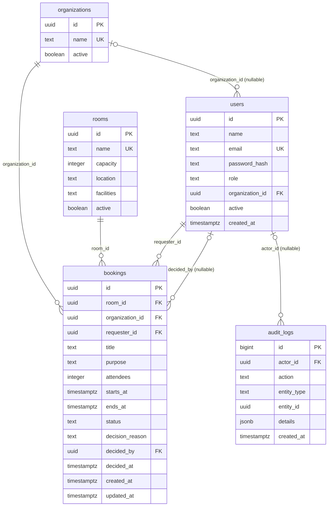

# Desain database St Stefanus

Schema penuh tetap sama dengan project awal. Sumber yang dieksekusi adalah `migrations/001_initial.sql`; dokumen ini hanya panduan presentasi, bukan migration tambahan.



## Yang dipakai pada tahap login

- `users.email`: unik dan lowercase; dipakai untuk menemukan akun aktif.
- `users.password_hash`: salt dan hash scrypt; password asli tidak disimpan.
- `users.active`: user nonaktif tidak bisa login; token yang sudah terbit juga ditolak saat mengecek profil.
- `users.role`: ADMIN, SECRETARIAT, atau MEMBER. Role tersimpan untuk tahap otorisasi berikutnya.
- `users.organization_id`: relasi opsional ke organisasi. Data organisasi tetap tersedia untuk pengembangan berikutnya.

Saat login, query mencari email dengan `active = true`. Verifikasi hash dilakukan di Node.js. JWT berisi identitas `sub`, waktu terbit/kedaluwarsa, issuer dan audience; role dan status aktif dibaca lagi dari database pada request terproteksi. Response profil tidak menyertakan password hash.

## Desain untuk tahap berikutnya

- `rooms`: kapasitas harus positif; nama unik; ruangan bisa dinonaktifkan.
- `bookings`: relasi requester, organisasi, dan ruangan. Keputusan dapat mencatat user yang memutuskan serta alasannya.
- Status booking dibatasi ke PENDING, APPROVED, REJECTED, CANCELLED. Waktu akhir harus setelah waktu awal; attendee count positif.
- Constraint GiST `no_room_overlap` dengan extension `btree_gist` mencegah overlap untuk booking PENDING/APPROVED. Rentang `[start,end)` memperbolehkan jadwal yang berdampingan.
- `audit_logs`: aktor, aksi, entity, detail JSON, dan timestamp. `entity_id` adalah referensi generik aplikasi, **bukan foreign key** ke satu tabel tertentu. Tahap login ini belum menulis audit log login.
- `schema_migrations`: tabel teknis tambahan yang dibuat script migrasi untuk mencatat file SQL yang sudah diterapkan, bukan entity bisnis.

## Melihat tabel saat presentasi

```powershell
docker compose exec db psql -U booking -d booking -c "\dt"
docker compose exec db psql -U booking -d booking -c "\d users"
docker compose exec db psql -U booking -d booking -c "\d bookings"
docker compose exec db psql -U booking -d booking -c "SELECT id,name,email,role,active FROM users;"
```

Bisa juga memakai pgAdmin/DBeaver: host `localhost`, port `5434`, database `booking`, user `booking`, password lokal default `booking_local_only`.
